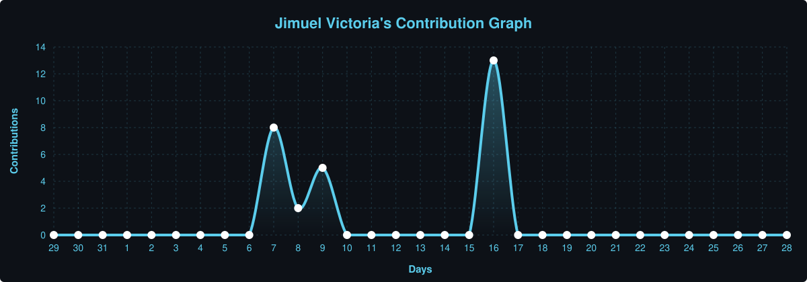

  
  
  
  

  

## 🚀 About Me

I build end-to-end digital solutions with a focus on performance and maintainability. Deeply embedded in the **Laravel ecosystem**, I move fluidly between **VILT** and **TALL** stacks while extending reach to mobile via **Kotlin**, **React Native**, and **Flutter**. 

Basically, I am dedicated to writing clean, maintainable code and designing architectures that stand the test of time.

---

## 💼 Technical Arsenal

### 🔹 The Core (Full Stack)

### 🔹 Mobile Development

### 🔹 Backend & API

---

## ♟️ AFK (Away From Keyboard)

When I'm not deploying code, I'm usually focusing on strategy and exploration:
* 🧠 **Chess:** Analyzing grandmaster games and grinding ELO.
* 🚴 **Cycling:** Exploring new routes and endurance riding.
* ✈️ **Travel:** Seeking new perspectives and environments.

   
  

<!-- 

  

   
  

-->

<!-- 

---

  
  
  
  

-->
